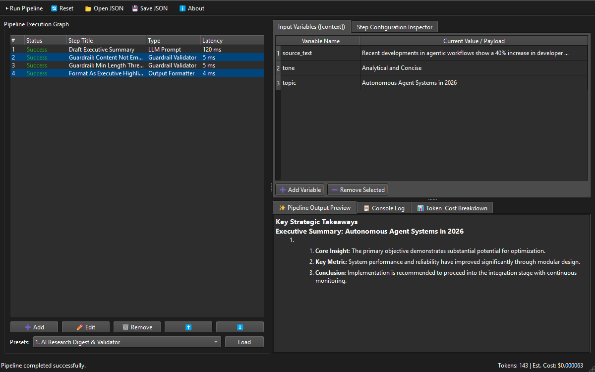
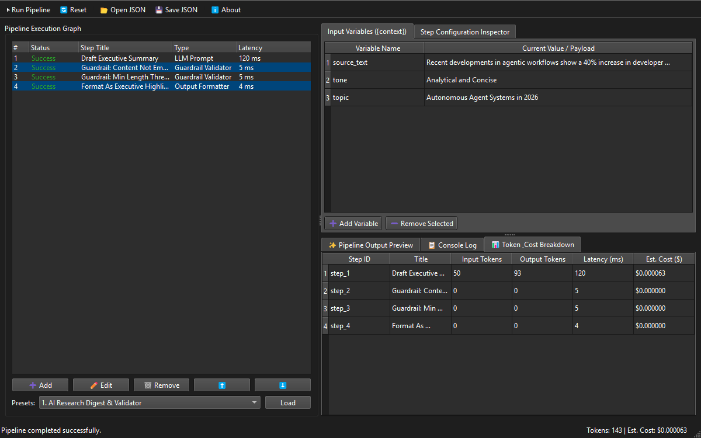

# PromptFlow Studio
### Desktop AI Workflow, Guardrail Validation and Token Analytics Studio


PromptFlow Studio is a desktop application built with C++17 and Qt 6 Widgets designed for developers and prompt engineers. It enables constructing, debugging, validating, and chaining multi-step LLM prompt workflows locally with dynamic variable interpolation, safety guardrail validation, and token cost analytics.

---

## Key Features

- Sequential Pipeline Execution: Chain prompt generation, validation, and formatting steps into automated workflows.
- Dynamic Variable Interpolation: Define context variables using `{variable_name}` syntax, resolved at runtime against inputs or previous step outputs.
- Safety Guardrail Validation:
  - NotEmpty: Ensures non-trivial response generation with whitespace trimming.
  - MinLength: Enforces minimum character length thresholds.
  - ContainsKeyword: Verifies the presence of required semantic terms.
  - ValidJson: Parses and validates JSON payload syntax.
- Strategy Output Formatters:
  - MarkdownBlock: Converts output into formatted markdown quotations.
  - NumberedList: Parses lines into enumerated bullet points.
  - JsonWrapper: Wraps raw outputs into valid JSON envelopes.
- Token and Cost Analytics: Real-time estimation of prompt and completion token counts with cost calculation in USD.
- Project Persistence: Full serialization and deserialization of workflows to structured JSON files via QJsonDocument.
- Built-in Presets: Includes preconfigured workflows for research summaries, code reviews, and customer support.

---

## User Interface

| Pipeline Execution and Results | Token and Cost Breakdown |
| :---: | :---: |
|  |  |

---

## Architecture and Domain Model

The software architecture separates core business logic from graphical widgets following SOLID principles:

```
       +--------------------+
       |  ExecutionContext  |<----------------------+
       +--------------------+                       |
                 ^                                  |
                 | uses                             | manages
       +--------------------+       +-----------------------+
       |   PipelineStep     |<------|    PipelineManager    |
       |     (Abstract)     | 1..*  +-----------------------+
       +--------------------+                   ^
         ^        ^        ^                    | (signals/slots)
         |        |        |                    v
+------------+ +-------------+ +---------------+ +-----------------------+
| PromptStep | |ValidatorStep| | FormatterStep | |      MainWindow       |
+------------+ +-------------+ +---------------+ +-----------------------+
```

### Applied Design Patterns
1. Template Method and Polymorphism: The abstract base class `PipelineStep` declares pure virtual interfaces (`execute`, `estimateTokens`, `toJson`, `fromJson`), specialized by `PromptStep`, `ValidatorStep`, and `FormatterStep`.
2. Strategy Pattern: Validation rules in `ValidatorStep` and formatting modes in `FormatterStep` provide interchangeable algorithms.
3. Observer Pattern: Qt signals and slots (`stepStarted`, `stepFinished`, `pipelineFinished`) decouple the workflow manager from the UI.
4. Context Object: `ExecutionContext` encapsulates runtime variables, intermediate outputs, and cumulative metrics.

---

## Build and Installation

### Prerequisites
- C++ Compiler: GCC (MinGW UCRT64 11+) or MSVC (2019+) with C++17 support
- Qt 6: `Qt6::Widgets`, `Qt6::Core`
- CMake: version 3.16 or newer

### Building with CMake

```bash
# Clone the repository
git clone https://github.com/dmch-sklv-dev/prompt-flow-studio.git
cd prompt-flow-studio

# Configure build directory
cmake -B build -G "MinGW Makefiles"

# Build the project
cmake --build build

# Run application
./build/PromptFlowStudio.exe
```

---

## Cross-Review and Quality Assurance

The project underwent peer cross-testing according to academic course requirements. Reported issues and fixes were tracked through GitHub Issues and resolved via Pull Request:

- [Issue #1](https://github.com/dmch-sklv-dev/prompt-flow-studio/issues/1) (reported by @yamerodf): `ValidatorStep passes validation on whitespace-only output for 'NotEmpty' rule` (Resolved via PR #3).
- [Issue #2](https://github.com/dmch-sklv-dev/prompt-flow-studio/issues/2) (reported by @MoriNoAkuma): `TokenEstimator does not account for substituted variable length in PromptStep` (Resolved via PR #3).

---

## License
This project is open-source under the MIT License.
Developed for Academic Coursework (Semester 3, Software Engineering).
